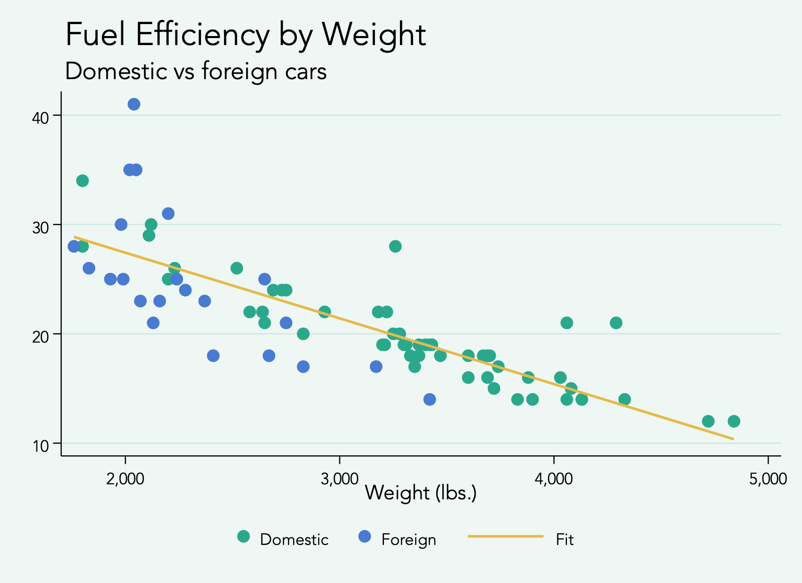
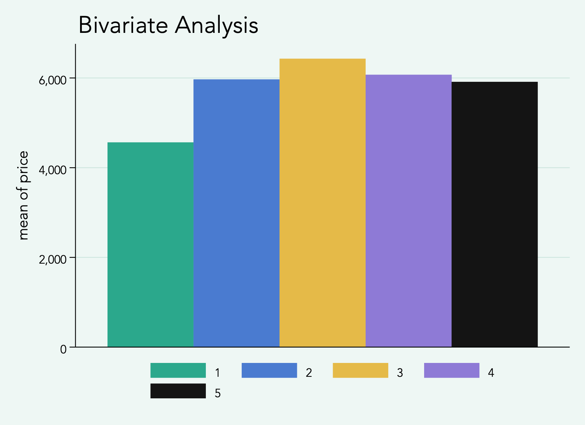
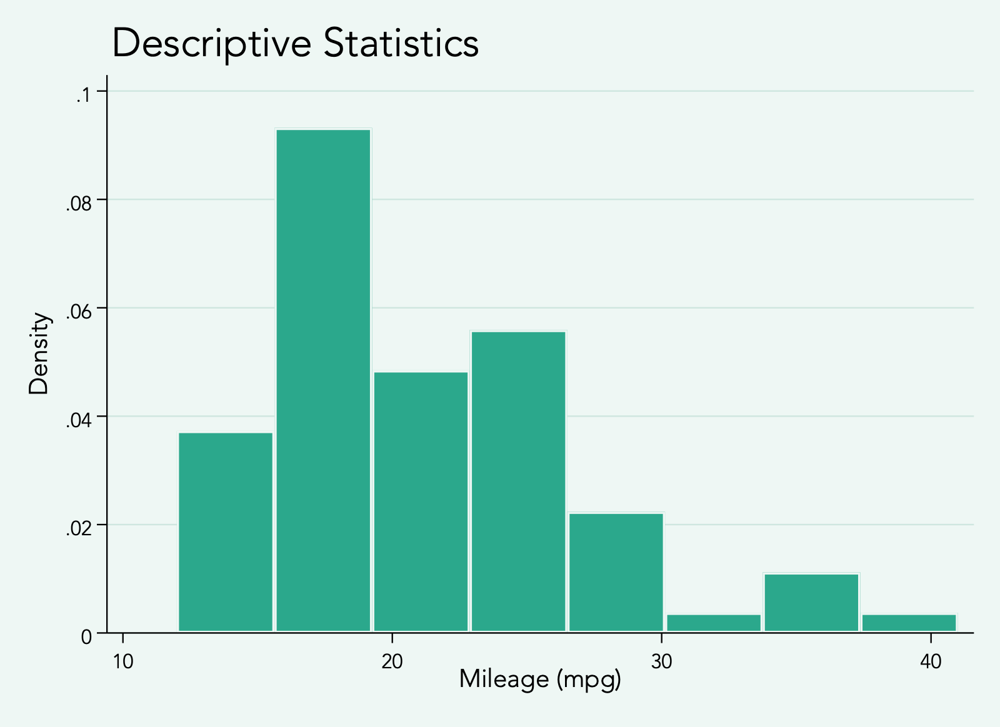

# AdStats Stata scheme

A Stata graph scheme matching the AdStats *Survey Research Report* presentation: pale mint background, black text, thin black axes, faint horizontal gridlines, and a teal / blue / gold / lavender palette.



## Install

Copy `scheme-adstats.scheme` into your Stata `PERSONAL` folder (run `sysdir` in Stata to find it; on macOS it is usually `~/Documents/Stata/ado/personal/`).

Or install directly from Stata:

```stata
net install adstats, from("https://raw.githubusercontent.com/mmelanie/adstats-scheme/main/") replace
```

## Use

```stata
set scheme adstats, permanently
* or for a single graph
scatter mpg weight, scheme(adstats)
```

## Palette

| Series | Colour | RGB |
|---|---|---|
| p1 | Teal | 43 168 140 |
| p2 | Cornflower blue | 74 123 208 |
| p3 | Warm gold | 229 186 72 |
| p4 | Lavender | 142 122 214 |
| p5 | Ink black | 20 20 20 |
| p6–p15 | Light and dark variants | see scheme file |

## Fonts

Schemes can't set the typeface. For bold titles like the deck, use `title("{bf:Your Title}")`, or change the font for all graphs with `graph set window fontface "Helvetica Neue"`.

## Examples

| Bar | Histogram |
|---|---|
|  |  |
